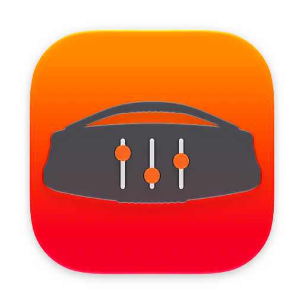
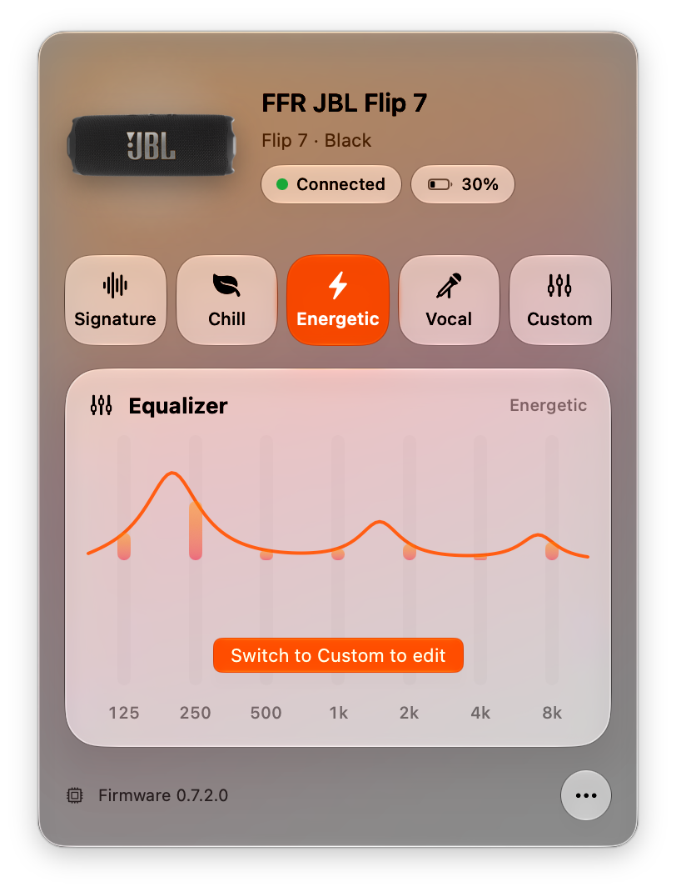
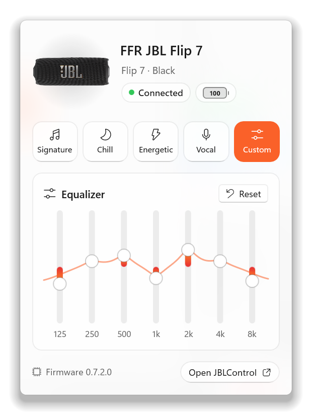
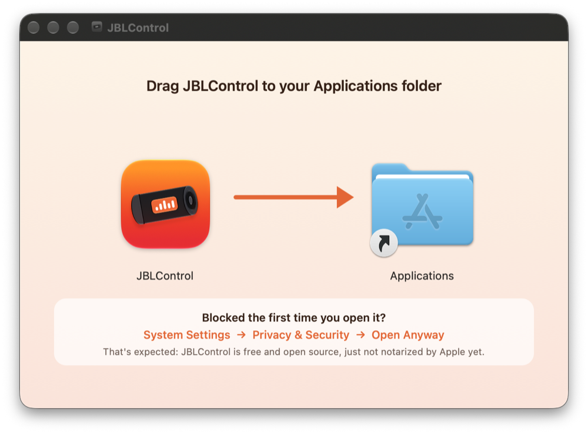
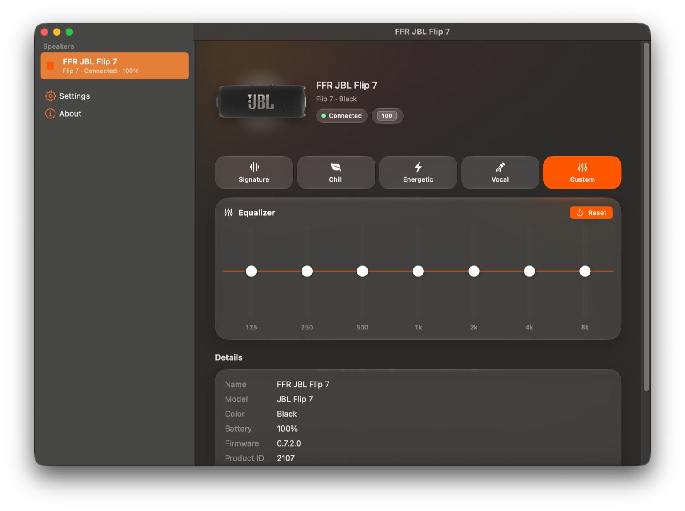
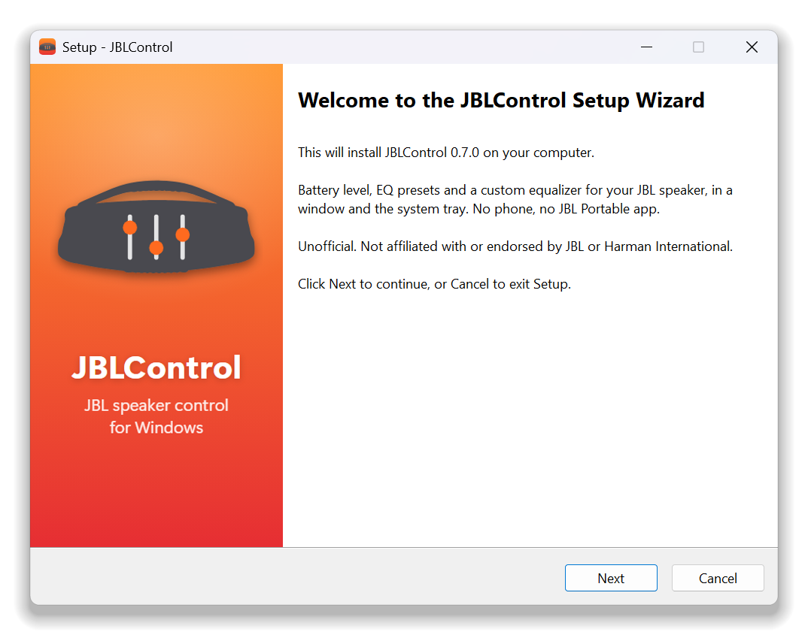
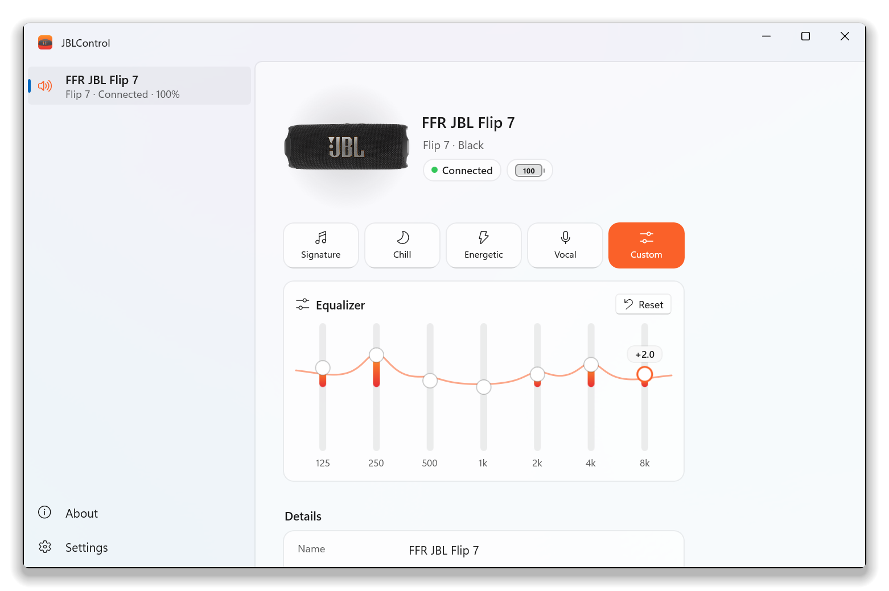

<p align="center">
  
</p>

<h1 align="center">JBLControl</h1>

<p align="center"><b>JBL speaker control on your Mac and Windows PC.</b></p>

<p align="center"><a href="https://ffrafat.github.io/JBLControl/"><b>ffrafat.github.io/JBLControl</b></a></p>

<p align="center">
  <a href="../../releases/latest"></a>
  
  
  <a href="LICENSE"></a>
</p>

<p align="center">
  
  &nbsp;
  
</p>

Battery level, EQ presets and a custom equalizer for JBL Flip, Charge, Xtreme, Go, Clip, Pulse, Boombox and
more. On both platforms it's an app window plus a compact panel from the menu bar (Mac, Liquid Glass on Tahoe)
or system tray (Windows). No phone, no JBL Portable app.

> Unofficial. Not affiliated with or endorsed by JBL or Harman International.

## Features

- 🔋 Battery, model, color and firmware at a glance
- 🎚️ JBL's EQ presets (Signature, Chill, Energetic, Vocal…) and a custom equalizer with a live response curve
- 🔄 Auto-reconnects, even though JBL speakers rotate their Bluetooth address
- 🖼️ The speaker shown in its actual color
- 🔀 One-click switching when several JBL speakers are nearby
- ☕ Keep Awake: stops the speaker's auto power-off while your computer is playing to it (JBL has no setting for this)
- ⚙️ Settings: launch at login, low-battery alerts, update checks
- 🧪 Built-in diagnostics report, so owners of untested models can help add support

| | Mac | Windows |
|---|---|---|
| Where it lives | App window + menu bar icon (click for a compact panel) | App window + system tray icon (click for a compact panel) |
| Requirements | macOS 14 Sonoma or later, Apple Silicon or Intel | Windows 10 (1809) or later, x64 or Arm64, with Bluetooth |
| Download | `JBLControl-<version>.dmg` | `JBLControl-win-x64-<version>-setup.exe` (or `win-arm64`) |
| Status | Stable | **Preview**: verified with a Flip 7 on Windows 11 |

## Supported speakers

| Status | Models |
|---|---|
| ✅ Verified | Flip 7, Charge 6, Charge 5 |
| 🟠 Beta | Xtreme 3, Xtreme 4, Go 4, Go 4 Duo, Clip 5, Tuner 3 |
| 🟣 Experimental | Go 5, Grip, Xtreme 5, Boombox 2/3/4, Flip 6, Pulse 5, Flip/Charge Essential 3 SE, older models |

Full list with product IDs: [docs/SUPPORTED_MODELS.md](docs/SUPPORTED_MODELS.md). Both apps share the same
protocol code and model list. Verification so far was done on a Mac, except the Flip 7, which is also verified
on Windows.

Beta and experimental models read battery and EQ safely. Changing their EQ needs **Allow experimental EQ**
(Settings, on both) until someone with that speaker confirms it works.

**Have a beta or experimental model?** Choose **Copy Diagnostics** (Mac: the ••• menu; Windows: right-click
the tray icon) and paste it into a [device report](../../issues/new?template=device-report.yml). It only sends
read-only requests, and it hides your speaker's MAC address and serial number.

## Install on Mac

**Requirements:** macOS 14 Sonoma or later, on Apple Silicon or Intel. On macOS 26 Tahoe and later the panel uses Liquid Glass; on Sonoma and Sequoia it uses the classic translucent look.

### Install in 3 steps

1. **Download** `JBLControl-<version>.dmg` from the [latest release](../../releases/latest).
2. **Open the DMG** and drag **JBLControl** onto the **Applications** folder.

   

3. **Open JBLControl** from Applications (or Spotlight). The first time, macOS will block it.
   That's expected; see [below](#if-macos-blocks-jblcontrol) for why and how to allow it.
   Then click **Allow** when it asks for **Bluetooth**.

The JBLControl window opens and a speaker icon appears in the menu bar. Turn your JBL speaker on; JBLControl
finds it by itself.

### Using it



- The **window** lists each nearby speaker in the sidebar; click one to switch to it. The connected speaker is
  shown in full: presets, the custom equalizer, battery, firmware and Keep Awake. **Settings** and **About**
  are at the bottom of the sidebar.
- **Closing the window keeps JBLControl running in the menu bar.** It then has no Dock icon until you open
  the window again. **Click** the menu bar icon for a compact panel with presets and the equalizer; its
  **Open JBLControl** button and ••• menu bring the window back, as does opening JBLControl from
  Applications or Spotlight.
- Launched at login, it starts quietly in the menu bar.

> Close the JBL Portable app on your phone if JBLControl can't connect: speakers accept one control
> connection at a time.

**Start at login:** **Settings** → General → **Launch at login**.

**Update:** quit JBLControl (⌘Q, or ••• → **Quit**), then install the new DMG the same way and choose **Replace**.

**Uninstall:** quit it and drag JBLControl from Applications to the Trash. Optionally also delete
`~/Library/Caches/io.github.jblcontrol` (speaker photos cached by older versions).

### Keep Awake

JBL portables switch themselves off after roughly 10–20 minutes without sound, and JBL offers no way to
change that (except on the Go 5 and Xtreme 5). Turn on **Keep speaker awake** (Settings → Speaker, or
••• → Keep Speaker Awake) and, while the speaker is your Mac's sound output, JBLControl plays a 2-second,
inaudible 30 Hz tone every 5 minutes so the speaker never sees long enough silence.

- Works with any JBL speaker, but only when your Mac is the audio source (not a phone).
- While it's on, the menu bar speaker turns orange and the panel shows a cup; click the cup to turn it off.
- The speaker keeps using battery while it stays on.

### If macOS blocks JBLControl

The first time you open it, macOS shows **"JBLControl" Not Opened** with *"Apple could not verify
'JBLControl' is free of malware…"*.

**Why this happens.** Every app downloaded from the internet is checked by Gatekeeper, the macOS feature
that lets an app open straight away only if Apple has *notarized* it. Notarization means the developer
paid for the Apple Developer Program (US$99 a year) and Apple's servers scanned that build. JBLControl is a
free, unpaid hobby project, so it isn't notarized [yet](#support-the-project). The warning means Apple
hasn't checked this build. It doesn't mean macOS found anything wrong with it.

**Is it safe?** Only open software you trust; here's what you can check for this one:

- **All the code is public** in this repository, and each release is built from it with
  `scripts/build-app.sh`. You can read it, or [build it yourself](#build-from-source).
- **It doesn't need an account or any personal data.** It uses Bluetooth to talk to your speaker, plus the
  internet only to check GitHub for new versions.
- **You can check that your download wasn't tampered with.** Each release lists SHA-256 checksums; in
  Terminal, `shasum -a 256 ~/Downloads/JBLControl-<version>.dmg` should print the same value.

Allowing it is a one-time step for this app only. It doesn't turn Gatekeeper off for anything else.

#### Option A: System Settings (no Terminal)

1. Open JBLControl. When macOS says it can't be opened, click **Done** (not *Move to Trash*).
2. Open **System Settings → Privacy & Security** and scroll down to **Security**.
3. Next to *"JBLControl" was blocked to protect your Mac*, click **Open Anyway**.
4. Confirm with **Open Anyway** and your password or Touch ID.

On **macOS 14 Sonoma** you can instead right-click (or Control-click) JBLControl in Applications,
choose **Open**, then **Open** again.

#### Option B: Terminal

```bash
xattr -dr com.apple.quarantine /Applications/JBLControl.app
```

Then open JBLControl normally.

What it does: when you download a file, macOS tags it with a *quarantine* flag, and Gatekeeper only checks
apps that carry that flag. This command removes the flag from JBLControl (`-d` deletes the attribute, `-r`
applies it to everything inside the app). It changes nothing else on your Mac and doesn't turn off Gatekeeper.
Don't use commands such as `sudo spctl --master-disable` that you may see suggested online: they turn off
Gatekeeper for every app.

## Install on Windows

> **Preview.** Everything the Mac app does, verified with a JBL Flip 7 on Windows 11. Other models use the
> same protocol code but haven't been tried from Windows yet; a
> [device report](../../issues/new?template=device-report.yml) helps either way.

**Requirements:** Windows 10 version 1809 or later (tested on Windows 11), x64 or Arm64, with Bluetooth.
Nothing else to install: the download includes everything it needs.

### Install in 3 steps

1. **Download** `JBLControl-win-x64-<version>-setup.exe` from the [latest release](../../releases/latest)
   (`win-arm64` for Arm PCs, such as Snapdragon laptops).
2. **Run it.** Windows will probably warn you first; see [below](#if-windows-blocks-jblcontrol).
   The installer doesn't need administrator rights. You can choose to start JBLControl when you sign in
   and to add a desktop shortcut.

   
3. **Finish**, and JBLControl opens. Turn your JBL speaker on nearby; it finds it by itself.

> Close the JBL Portable app on your phone if JBLControl can't connect: speakers accept one control
> connection at a time.

### Using it



- The **window** lists each nearby speaker on the left; click one to switch to it. The connected speaker is
  shown in full: presets, the custom equalizer, battery, firmware and Keep Awake. **Settings** and **About**
  are at the bottom.
- **Closing the window keeps JBLControl running in the system tray** (the icons by the clock).
  **Click** the tray icon for a compact panel with presets and the equalizer, **right-click** it for
  Keep Speaker Awake, Settings, Copy Diagnostics, About and **Quit**, or **double-click** it to bring the
  window back.
- If the tray icon isn't visible, Windows put it in the hidden icons (**^**): drag it onto the taskbar, or turn
  it on in **Settings → Personalization → Taskbar → Other system tray icons**.
- **Keep Awake** works as on the Mac, while this PC is the speaker's sound output (choose it in
  **Settings → System → Sound**).

**Start at login:** Settings → **Launch at login** (or the option in the installer). It then starts quietly in
the tray.

**Update:** run the new installer. It closes JBLControl, updates it and keeps your settings.

**Uninstall:** **Settings → Apps → Installed apps → JBLControl → Uninstall**. Your settings stay in
`%LOCALAPPDATA%\JBLControl` in case you reinstall; delete that folder to remove them too.

**Prefer no installer?** Each release also has a portable `JBLControl-win-x64-<version>.zip`: extract it
anywhere and run `JBLControl.exe`.

### If Windows blocks JBLControl

Like the Mac app, the Windows build isn't signed with a paid code-signing certificate [yet](#support-the-project),
so Windows warns before running it. The same checks as for the Mac app apply: all the code is in this
repository, each release is built from it with `scripts/build-windows.ps1`, and each release lists SHA-256
checksums. In PowerShell, `Get-FileHash ~\Downloads\JBLControl-win-x64-<version>-setup.exe` should print
the same value.

- **"Windows protected your PC"** (SmartScreen): click **More info**, then **Run anyway**. You only need to
  do this once for each download.
- **"Smart App Control blocked an app"**: Smart App Control only runs signed apps and has no per-app
  exception, so JBLControl can't run while it's on. It's in **Windows Security → App & browser control →
  Smart App Control**. Turning it off is your decision: on many PCs it can't be turned back on without
  resetting Windows, while Microsoft Defender keeps protecting you either way.

## Build from source

```bash
git clone https://github.com/ffrafat/JBLControl.git
cd JBLControl
```

### Mac

Needs Xcode 26 or later (the app itself runs on macOS 14+). Builds are universal (Apple Silicon + Intel).

```bash
scripts/build-app.sh --install --run   # builds, copies to /Applications, launches
swift test                             # protocol tests, including real Flip 7 captures
```

Open `Package.swift` in Xcode to work on it. The build script signs with your Apple Development identity if
you have one, so the Bluetooth permission survives rebuilds. `scripts/build-app.sh --zip` also writes a
release zip to `build/`.

### Windows

Needs the [.NET 10 SDK](https://dotnet.microsoft.com/download) (`winget install Microsoft.DotNet.SDK.10`);
no Visual Studio required. Building the installer also needs Inno Setup 6 (`winget install JRSoftware.InnoSetup`).

```powershell
dotnet test windows/JBLControl.Windows.slnx                                        # protocol tests (the same fixtures as the Swift tests)
powershell -ExecutionPolicy Bypass -File scripts/build-windows.ps1 -Install -Run   # build, install, launch
powershell -ExecutionPolicy Bypass -File scripts/build-windows.ps1 -Installer -Zip # release installers and zips
```

`-Install` copies it to `%LOCALAPPDATA%\Programs\JBLControl` with a Start menu entry. `-Installer` and `-Zip`
write the x64 and arm64 setup programs and portable zips, with their SHA-256 checksums, to `build/`. The
plan and status of the port are in [windows/PORT_PLAN.md](windows/PORT_PLAN.md).

## How it works

JBL speakers expose a control service over Bluetooth LE (`65786365-6C70-6F69-6E74-2E636F6D0000`).
JBLControl speaks the same protocol as JBL's own app. There are two generations, legacy `AA` frames and
"Protocol 4" `DD 00` frames, plus four EQ encodings. See [docs/PROTOCOL-FLIP7.md](docs/PROTOCOL-FLIP7.md).

| Path | What |
|---|---|
| `Sources/JBLControlKit` | Protocol library: frame codecs, EQ codecs per family, model catalog. No UI, fully tested |
| `Sources/JBLControl` | The Mac app: CoreBluetooth, SwiftUI window and menu bar panel, diagnostics |
| `windows/JBLControlKit.Windows` | The protocol library ported to C#, checked against the same test fixtures |
| `windows/JBLControl.Windows` | The Windows app: WinUI 3 window and tray, Windows Bluetooth LE |
| `windows/Installer` | The Windows installer (Inno Setup) and its artwork |
| `scripts/generate-catalog.py` | Regenerates the model catalog (Swift and C#) from the JBL app's model data |
| `scripts/make-icon.py` | Regenerates the Liquid Glass app icon (`Resources/AppIcon.icon`, opens in Icon Composer) |
| `scripts/make-windows-icons.ps1` | Renders the Windows app icon, tray icon and installer artwork from the Mac icon |
| `Tools/Probe` | Standalone read-only BLE probe for reverse-engineering new models |

## Contributing

Contributions of every size help:

- **Own a beta or experimental speaker?** Send a [device report](../../issues/new?template=device-report.yml)
  with the output of **Copy Diagnostics**. This is the most useful thing you can do: it's how models
  get verified. Reports from Windows are just as welcome.
- **Code:** protocol work, new models, UI on either platform. See [CONTRIBUTING.md](CONTRIBUTING.md).
- **Speaker photos:** missing your model or color? See [CONTRIBUTING.md](CONTRIBUTING.md#add-a-speaker-photo).
- **Bugs and ideas:** [open an issue](../../issues).

## Support the project

JBLControl is free and open source. Right now every download triggers a warning on both platforms: shipping
a properly signed and **notarized** Mac app needs an Apple Developer Program membership (**US$99 a year**),
and a Windows code-signing certificate costs about as much again. Donations go first to those fees, then to
buying the speakers people are waiting on so they can be tested on real hardware.

- ❤️ [GitHub Sponsors](https://github.com/sponsors/ffrafat)

Can't donate? A ⭐ on GitHub or a device report helps just as much.

## Credits

JBLControl stands on the shoulders of people who reverse-engineered JBL's protocol first:

- **[openjbl](https://github.com/NiceDayZc/openjbl)** by OpenJBL contributors (MIT). The foundation of
  this project: the JBL Portable protocol analysis (frame formats, EQ command families, Protocol 4), the model
  catalog and preset data that `scripts/generate-catalog.py` turns into JBLControl's model list, and the
  hardware-verified Charge 6 profile.
- **[jbl-charge5](https://github.com/hudsonbrendon/jbl-charge5)** by Hudson Brendon (MIT). Documented the
  BLE control service and the speaker-info tokens (name, battery, color, model) that JBLControl reads.
- **[connect-plus](https://github.com/pembem22/connect-plus)** and
  **[jbl-firmware](https://github.com/pembem22/jbl-firmware)** by pembem22. Earlier open work on configuring
  JBL speakers, used as a reference only (no code from them is included).

Third-party license texts are in [THIRD_PARTY_NOTICES.md](THIRD_PARTY_NOTICES.md).

## License

[MIT](LICENSE).

JBLControl is an independent project, not affiliated with, endorsed or sponsored by JBL or Harman
International. JBL is a trademark of Harman International Industries, Incorporated. The speaker product photos
included to identify each model are Harman's and remain their property.
